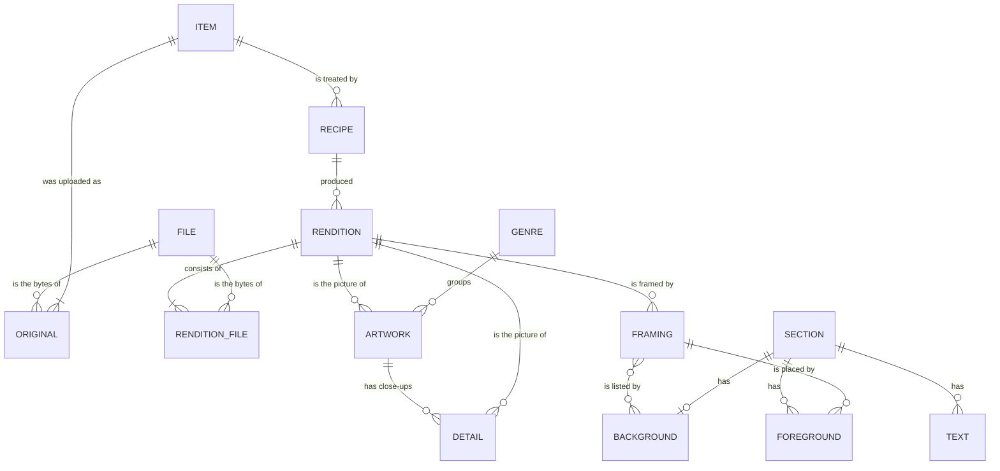

# The entity model

**Status: agreed by Christopher, 16 Nov 2026 (all six decisions in section 8). Slice 2 builds to it.**
Written before uploads slice 2 (the plan, step 4, in CLAUDE.md). It covers the whole site, not only that slice,
so each later slice builds a piece of one design instead of carrying an old shape forward.

Where this is heading: today a painting's entry carries its file, its sizes, its preview and its darkroom
settings, so one thing is doing five jobs. This model gives each job its own entity, linked by ids, so that a
photo can be uploaded once and used many times (a painting, a background, a detail, later a portrait) without
anything being copied or renamed.

## 1. The shape of it: two layers

**The media layer** (top half: File, Library item, Original, Recipe, Rendition) is a record of facts: this was
uploaded, these settings produced those pictures. Nothing in it is ever a draft, and a Rendition never changes
once made. These are ordinary database tables with foreign keys.

**The editorial layer** (bottom half: Artwork, Genre, Detail, Framing, Background, Foreground, Section, Text,
Contact links, Settings) is what the client composes and what visitors see. Everything in it has a draft and a
published version, goes through Review and Publish, and has History. These stay as documents in the existing
`entries` table, because drafts, publishing and History all work on whole documents.

The two layers meet at exactly one point: **an editorial document names a Rendition by its id.** Reprocessing a
painting makes a new Rendition at once (media layer), but visitors see it only when the Artwork's draft, which
now names the new Rendition, is published (editorial layer). That is how it behaves today (a painting's entry
already says `rendition: r2`); the model only makes the join explicit.

Both glossary words keep their meanings: the **Recipe** is the darkroom settings, the thing edited; a
**Rendition** is one frozen set of resized pictures that a recipe produced. Neither replaces the other. (The glossary says an Artwork "points at a recipe". It still belongs to one, but through the
Rendition it names: naming the Recipe itself would let a darkroom change reach visitors without being published.)

In Kimball's terms, the media layer is the conformed dimensions, shared by everything, and each use (Artwork,
Background, Foreground) is a mart that points at them and never keeps its own copy.

## 2. The media layer (tables)

### File
One row for each distinct piece of content held in storage. A file is known by the SHA-256 digest of its bytes
and by nothing else: no name, no folder, no meaning.

| Attribute | Notes |
|---|---|
| `digest` (key) | SHA-256 of the bytes, 64 hex digits. Also its key in R2 and its public address |
| `bytes` | size |
| `type` | content type (image/jpeg, video/mp4) |
| `w`, `h` | pixels |
| `seconds` | videos only |
| `added`, `added_by` | when first stored, and by whom |

Consequences: the same content is stored once, automatically (today's separate "already stored?" check goes);
a file can never change under its address, so visitors' copies never go stale and nothing needs purging except
after Delete for good; a file is deleted from storage when no Original and no Rendition refers to it.

### Library item
One thing the client uploaded, and what is true of the picture itself whatever it is used for.

| Attribute | Notes |
|---|---|
| `id` (key) | the code, 8 hex digits, as now (existing codes carry over) |
| `kind` | photo or video |
| `name` | what the Library shows; changed freely |
| `alt` | alternative text (new) |
| `credit` | who made it, if not him (new) |
| `added`, `added_by` | |

Goes: `grp` (site or painting). Being a painting is a use, not a property of the photo, so the Library's two
lists become a filter on what uses each item. Goes: `hash` and the `data` record of parts (now File, Original
and Rendition rows).

### Original
The untouched uploaded file or files of an item. A photo has exactly one; a video has one for each of its
versions (the set).

| Attribute | Notes |
|---|---|
| `digest` (key) | which File |
| `item_id` | which item |

A given File is the Original of at most one item (which is why the digest alone is the key), so uploading the
same photo again finds the existing item.

### Recipe
The darkroom settings applied to an item. It is what gets edited. Several per item: a pentaptych photographed
once is one item with five recipes.

| Attribute | Notes |
|---|---|
| `id` (key) | number |
| `item_id` | whose settings |
| `kind` | flat (four corners, squared up), scene (straighten and crop), video (stills only) |
| `label` | optional, to tell several apart ("left panel") |
| `settings` | the current choices: white balance (spots, brightness, warmth, starting from the paper or not), corners, shape; or angle and crop |
| `changed`, `changed_by` | |

`shape` (the proportions a flat thing is squared up to) is an input to the recipe. When an Artwork has a measured
size and "square up to its measured proportions" is ticked, the editor copies the size's proportions into the
recipe. The size itself stays on the Artwork: the Artwork drives the Recipe, never the reverse, as agreed.

`white_paper` moves here from the painting (it is about how the photo is treated, not about the artwork).

### Rendition
One frozen set of resized pictures that a recipe produced (the darkroom's output): r1, r2 and so on. Never
changed, never overwritten.

| Attribute | Notes |
|---|---|
| `id` (key) | number; this is what editorial documents name |
| `recipe_id` + `n` | which recipe, and its number within it (unique together) |
| `settings` | a frozen copy of the recipe's settings at the time, so the result can be made again |
| `region` | optional: a rectangle within the squared-up picture. Empty means the whole. Used by Details (step 7) |
| `w`, `h` | pixels of its largest size |
| `made`, `made_by` | |

### Rendition file
The files a rendition consists of.

| Attribute | Notes |
|---|---|
| `rendition_id` + `digest` + `role` (key) | which rendition, which File, as what (one file can be both the first and the last frame of a still video) |
| `role` | size (a picture at one width), preview (for link previews), first or last (a video's frames), version (a video version, passed through) |
| `width` | pixels across |
| `shape` | wide or tall (videos) |

A video's rendition lists the video's own versions with the role "version". They are the same Files as its
Originals; because files are known by digest, listing them costs nothing and copies nothing. This gives one
rule for what visitors may fetch (section 5) with no special case for video.

## 3. The editorial layer (documents in `entries`)

Each has `draft` and `published`, appears in Review and History, and can be hidden where marked. Ids as now
(a prefix and a name or random part). Links to other documents are by id; the server checks them on saving and
on publishing, as it does today for genres. Where a document names a Rendition, a generated column (D1's
recommended way to index a value inside JSON) exposes it, so "what uses this?" and "may a visitor fetch this?"
are each one indexed query rather than a read of every document.

| Entity | Attributes | Links |
|---|---|---|
| **Artwork** (kind `artwork`, was `painting`) | name (its address), title, medium, cm, year, estimated, size_shown, order, wide, featured, hidden | one Genre; one Rendition |
| **Genre** (kind `genre`, was `section`) | title, order, hidden | |
| **Detail** (step 7) | order, caption | one Artwork; one Rendition (one with a region) |
| **Framing** | focus point; crop for wide screens and crop for upright ones; for a video, how it plays (once or loop) and what reduced-motion visitors get (last frame or fade) | one Rendition |
| **Background** (one per section) | shade, hidden | an ordered list of Framings (one shown; a carousel later) |
| **Foreground** (step 6) | caption, side, width, where among the text | one Section; one Framing |
| **Section** (step 6) | page, order, type (hero, gallery, contact, profile, plain), hidden | |
| **Text** | the words | one Section, by its key |
| **Contact links** | a tick and a username for each site | |
| **Settings** | the floating wall's arrangement | |

What leaves the Artwork document, and where it goes:

| Today on the painting | Becomes |
|---|---|
| media, rendition (r1), ext, widths, w, h, preview | the one Rendition id; the rest is read from Rendition and Rendition file |
| process | the Recipe's settings (and each Rendition's frozen copy) |
| white_paper | the Recipe |
| details ("Oil on canvas, 60 x 90 cm, 2020") | not stored: worked out from medium, cm and year whenever shown |

What leaves the Background document: media, rendition, widths, w, h, versions and frames (all now the Rendition);
focus, play and calm (now the Framing). It keeps the shade and gains the list.

Later, same pattern, no new machinery: **Portrait**, **Team member** (uses that name a Framing).

### Users and roles (step 9, sketch only)
A table `user`: email (key), name, role, added. Cloudflare Access stays the sign-in; the role decides what the
editor allows. Every `..._by` column above holds that email.

## 4. The bus matrix: which step builds what

| | File | Item | Original | Recipe | Rendition | Artwork | Framing | Background | Section, Foreground | Detail | User |
|---|---|---|---|---|---|---|---|---|---|---|---|
| Step 4 slice 2 | build | reshape | build | build | build | repoint | | repoint | | | |
| Step 4 slice 3 (Library the only upload) | use | use | use | use | use | use | | | | | |
| Step 5 (backgrounds as lists) | | | | | use | | build | reshape | | | |
| Step 6 (edit in place) | | | | | | | use | use | build | | |
| Step 7 (details) | | | | use | use (region) | use | | | | build | |
| Step 9 (users) | | | | | | | | | | | build |

## 5. Storage and addresses

- **R2 key**: the file's digest, nothing else (`<64 hex digits>`). Names live in the database, never in storage.
- **Public address**: `/media/<digest>.<ext>`. The extension is only for browsers and people; the Worker looks
  up the digest.
- **Who may fetch a file**: visitors get a file only if it belongs to a Rendition that a published, not hidden
  document names (directly, or through a Framing). An Original of a photo is never in a Rendition, so it is
  never served. This closes the open review finding "a draft rendition of a published item can be fetched by
  guessing its address": the check is now per rendition, not per item, and a digest cannot be guessed anyway.
- **Caching**: a year, immutable, as now; but since an address can never mean different bytes, the purge after
  reprocessing goes. Only Delete for good purges.
- **Upload**: the browser works out the digest, asks whether it is already stored, and sends the file only if
  not. The Worker passes the digest to R2 with the upload, and R2 itself refuses the file if the bytes do not
  match it.
- **Delete for good**: removing an item removes its Originals, Recipes and Renditions (allowed only while no
  draft or published document names any of its Renditions; History as now), then every File nothing refers to.

## 6. Design checks against Cloudflare's documentation

| Decision | What Cloudflare recommends | This design |
|---|---|---|
| Files in R2, facts about them in D1 | The reference architecture "Storing user generated content": R2 for the files, D1 for their metadata | Follows it |
| Foreign keys between media tables | D1 enforces foreign keys by default and recommends them for relationships | Follows it in the media layer |
| Editorial content as JSON documents | D1 supports JSON columns, with generated columns and indexes for values queried often | Follows it, with one departure: a link inside a JSON document can't be a foreign key, so the server checks those. Reason: drafts, publishing and History need whole documents |
| Schema changes | Numbered migrations applied in the deploy command | Follows it (already in place) |
| Checking uploads | R2's `put` accepts a SHA-256 and rejects a mismatch | Follows it, and uses the same digest as the key |
| Uploading | The reference architecture sends the browser straight to R2 with a signed address, so large files don't pass through a Worker | Departs: uploads pass through the Worker. Reason: it keeps everything in one place with no R2 API keys to manage, and the free plan's limit (100 megabytes a request) is the reason the editor already stops videos at 95 megabytes. Worth revisiting for client sites with large videos |
| Sizes of a picture | The reference architecture "Optimizing image delivery with Cloudflare Image Resizing and R2": keep only originals, let Cloudflare Images resize on request (free plan: 5,000 distinct transformations a month, new ones failing beyond that) | Departs: the darkroom's sizes are made in the browser and stored. Reason: squaring up and white balance from spots are not things Images offers (it resizes, crops and converts), so a darkroom result must be stored whatever happens; storing its sizes too has no monthly limit and no dependency. The model doesn't close the door: a Rendition could later hold one full-size file and let Images make the sizes and modern formats, with no change to any table |
| Serving and caching | Cache through the Worker on a custom domain; long lifetimes for content that never changes under its address | Follows it; digest addresses make "never changes" literally true |

## 7. Getting there from today (slice 2, outline only)

1. Migration 0002 creates the five media tables, empty. Nothing uses them yet. **Done 16 Nov 2026**
   (migrations/0002_media_tables.sql, which is now the exact definition of section 2's tables).
2. A one-off editor button (as for the last move) walks every stored file: the browser fetches it, works out its
   digest and stores it under the digest. Done in the browser because the free plan gives a Worker 10
   milliseconds of processor time. Old keys stay until step 5.
3. The tables are filled from the Library's records and the paintings' `process` records. A painting moved from
   git with no `process` gets a recipe meaning "as supplied".
4. Entries and History are rewritten to the new documents (painting to artwork, section to genre), after a
   Time Travel bookmark, as was done on 11 Nov. Code switches over in the same release.
5. Once he has checked dev, then live: the old keys and the old columns are removed.

Every step before the last can be undone. Sizes today: dev 25 paintings, 46 Library items; live 25 paintings,
30 Library items.

## 8. Decisions (all agreed by Christopher, 16 Nov 2026)

1. **The two layers.** Media as tables that act at once; editorial as drafted documents.
2. **Uses name a Rendition**, not a Recipe, so nothing reaches visitors unpublished. Recipe and Rendition both
   keep their glossary meanings (his note on agreeing: the two words must not clash).
3. **Names.** Two new words, **File** and **Original**; the data's kinds renamed to match what the editor says,
   `painting` to `artwork` and `section` to `genre`, which frees "section" to mean only a page section.
4. **Library groups.** "Site pictures" and "Paintings" stop being a property of the item and become a filter on
   use (an item used both ways appears under both).
5. **Sizes stay stored** rather than resized by Cloudflare on request, for now (see section 6).
6. **Addresses** of the form `/media/<digest>.<ext>`.
